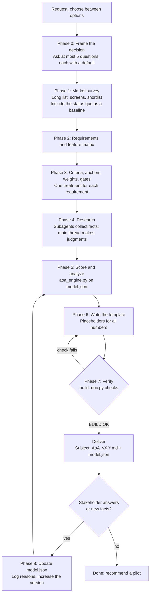

# Analysis of Alternatives (AoA) Skill

This skill helps an agent choose between options in a way that can be defended. Options can be tools, products, vendors or technologies. The output is a Markdown decision document with a versioned name, plus the model that produced the scores.

The method follows GAO and DoD AoA practice. The criteria come from ISO/IEC 25010. Must-have gates screen the options first, then weighted scores rank the options that pass. A sensitivity analysis shows how stable the result is.

## When to use it

Use it to:
- select a product, service, tool, platform, vendor or technology against requirements;
- do a trade study;
- update an existing AoA after the stakeholder answers questions.

Do not use it to:
- list alternatives when no decision is necessary;
- answer how-to questions about one product;
- look up a specification quickly.

## Workflow



## Phases

| Phase            | What the agent does                                                                                                                                                                                                                                                                                                                                  |
| ---------------- | ---------------------------------------------------------------------------------------------------------------------------------------------------------------------------------------------------------------------------------------------------------------------------------------------------------------------------------------------------- |
| 0. Frame         | Restates the decision and scope. Asks at most 5 questions before research, each with a recommended default. The questions cover use and scale, must-haves, cost treatment, environment, scope of alternatives and important personal preferences. If the user asks for autonomous work, the agent uses the defaults and records them as assumptions. |
| 1. Market survey | Makes a long list (usually 20–30) and screens it with named criteria, which gives a shortlist (usually 8–15). An alternative is a configuration that the user can adopt: product × tier × deployment × stack. If the user already has a tool, it becomes the status-quo baseline.                                                                    |
| 2. Requirements  | Lists requirements with priorities and builds a feature matrix (✅ native, ◐ partial, ❌ absent, ? not found).                                                                                                                                                                                                                                         |
| 3. Criteria      | Gives each requirement one treatment (see below). Sets anchors for each score, and sets weights for each profile, which must total 100. Sets one policy for unknown evidence before it scores.                                                                                                                                                       |
| 4. Research      | Uses vendor pages first. Subagents collect facts; the main agent makes all judgments. The agent checks limits in the vendor's own unit, and checks which plan includes a gating feature.                                                                                                                                                             |
| 5. Score         | Puts all inputs in `model.json` and runs the scoring engine.                                                                                                                                                                                                                                                                                         |
| 6. Write         | Writes the document as a template. Numbers and tables come from placeholders, and prose is used only for judgment.                                                                                                                                                                                                                                   |
| 7. Verify        | `build_doc.py` fills the template and runs checks. The agent also reads the summary against the results. The build must print `BUILD OK`.                                                                                                                                                                                                            |
| 8. Iterate       | Records each stakeholder answer and its effect, updates the model with a reason for each change, and builds a new version. Each version is complete without earlier versions.                                                                                                                                                                        |

## Criterion treatments

| Treatment | Effect on the ranking                                                                     |
| --------- | ----------------------------------------------------------------------------------------- |
| Gate      | Pass or fail before scoring. An option that fails is not ranked.                          |
| Weighted  | Scored 1–5 and weighted.                                                                  |
| What-if   | Scored 1–5 at weight 0. The engine reports the weight at which the top pick would change. |
| Recorded  | Collected for each option and shown in a table, but not scored.                           |

Gates come only from requirements that the stakeholder stated. If an unverified fact decides a gate, the default result is strict: "not found" fails. A lenient variant can be added case by case.

## Files

| File                         | Purpose                                                                                                                                                                             |
| ---------------------------- | ----------------------------------------------------------------------------------------------------------------------------------------------------------------------------------- |
| `SKILL.md`                   | Instructions for the agent: process, output template and conventions.                                                                                                               |
| `scripts/aoa_engine.py`      | Scoring engine (Python standard library only). It validates `model.json`, applies gates, ranks each profile, runs the sensitivity suite, and writes Markdown tables and `out.json`. |
| `scripts/build_doc.py`       | Document builder. It fills the placeholders, runs the document checks and writes the verification log.                                                                              |
| `references/model_schema.md` | The `model.json` schema, modeling patterns, the list of placeholders and a worked example.                                                                                          |

## Commands

```bash
# Score and analyze
python3 scripts/aoa_engine.py model.json --out build/ [--previous old_model.json]

# Build and check the document
python3 scripts/build_doc.py template.md --build build/ -o Subject_AoA_v1.0.md \
    [--stale "old phrase" ...] [--allow domainterm ...] [--analyst-review "what was checked"]

# Check an existing document only
python3 scripts/build_doc.py --check-only Subject_AoA_v1.0.md --build build/
```

`--previous` makes the change log. Each change in it needs a reason in `change_reasons`.

## Sensitivity suite

The engine runs these tests on the primary profile:
1. Each weight ±25%, then renormalized.
2. Equal weights.
3. Monte Carlo: 10,000 draws, each weight × U(0.5, 1.5).
4. Each score of the top two options ±1.
5. Gate variants.
6. The crossover weight for each what-if criterion.
7. Unknown scores changed to the alternate policy value.

Stability labels:
- **robust**: the leader wins ≥ 90% of draws and no single change flips the result;
- **leaning**: between robust and practical tie;
- **practical tie**: the leader wins < 70% of draws, or the margin is < 0.05.

The engine does not break ties. It reports the tied options as co-finalists and recommends a pilot.

The engine also makes a cost-vs-effectiveness table. This table shows each option's score without cost criteria, next to its total cost of ownership (TCO). It also marks dominated options, which are options for which another option is at least as effective and costs less.

## Output

- `<Subject>_AoA_v<x.y>.md`: 18 numbered sections and Appendices A–C, from the executive summary to the sources. Appendix C contains `model.json`.
- `model.json`, and `derive.py` if scores come from calculations.

## Requirements

- Python 3 (standard library only).
- Optional: `codespell` for the spelling check. If it is not installed, the verification log says "not run".
